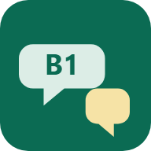
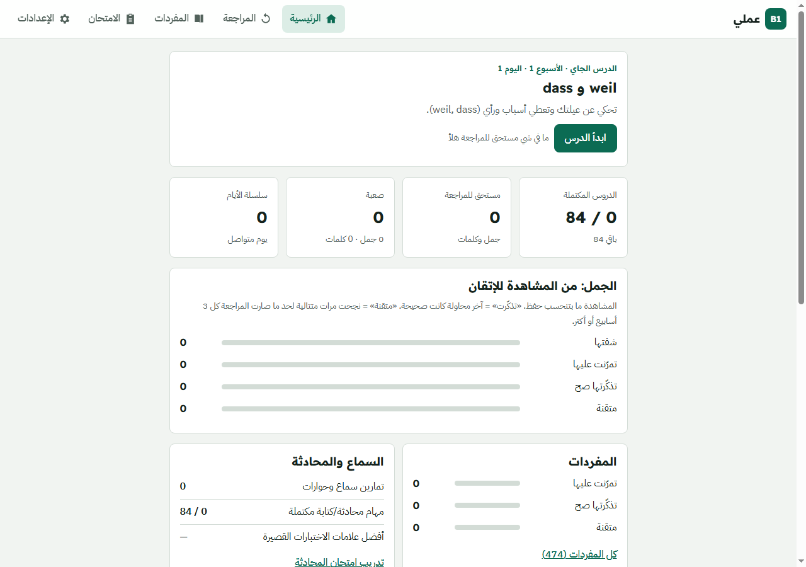
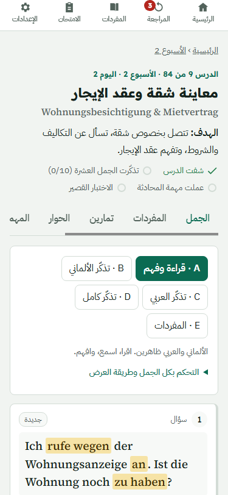
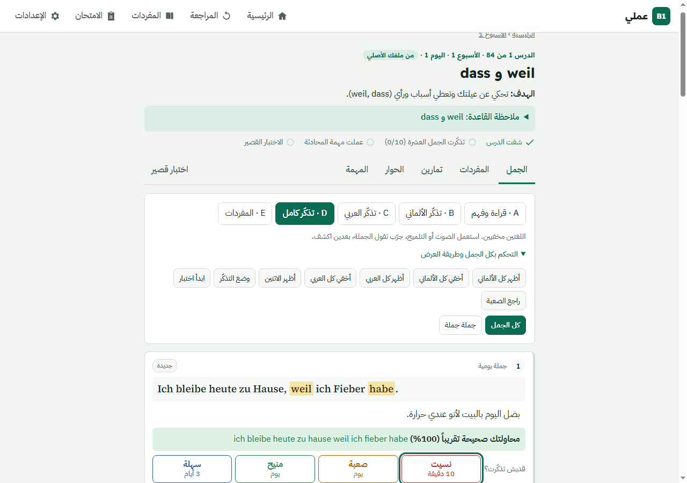

<div align="center">



# B1 عملي: Deutsch B1 Sprechtraining

**Eine Offline-first-Web-App, mit der Arabischsprachige gesprochenes Deutsch auf B1-Niveau üben.**

[🇬🇧 English](README.md) · 🇩🇪 Deutsch

[](https://github.com/MahmoudHasan2/b1-amali/actions/workflows/ci.yml)
[](https://mahmoudhasan2.github.io/b1-amali/)


**[▶ App öffnen](https://mahmoudhasan2.github.io/b1-amali/)**

</div>

---

## Über das Projekt

B1 عملي („B1, praktisch“) ist ein 12-Wochen-Kurs zum Deutschsprechen. Jede Lektion hat 10 Beispielsätze mit Übersetzungen ins levantinische Arabisch. Die Grammatik ist in jedem Satz hervorgehoben. Du übst, indem du eine oder beide Sprachen ausblendest und den Satz aus dem Gedächtnis abrufst. Ein Spaced-Repetition-System legt dir Sätze und Wörter genau dann wieder vor, bevor du sie vergessen würdest.

Die Oberfläche ist auf Arabisch (von rechts nach links), der deutsche Text steht darin von links nach rechts. Die App ist eine statische Progressive Web App: kein Framework, kein Build auf dem Server, und nach dem ersten Laden funktioniert sie komplett offline.

<p align="center">
  
  &nbsp;
  
</p>

## Funktionen

- **12-Wochen-Lehrplan:** 84 Lektionen und 840 Kernsätze. Jede Woche hat ein Thema (Wohnen, Arbeit, Gesundheit, Reisen, Medien, …) und einen Grammatikschwerpunkt.
- **Abrufmodi:** Lesen & Verstehen, Deutsch abrufen, Arabisch abrufen, vollständiger Abruf (beide ausgeblendet) und Wortschatz. Jede Sprache lässt sich pro Satz oder für die ganze Lektion ein- und ausblenden.
- **Spaced Repetition:** Nach jedem Abruf bewertest du dich selbst (vergessen / schwer / gut / leicht), und die App plant die nächste Wiederholung. Schwierige Einträge haben eine eigene Wiederholungsliste.
- **Hören & Sprechen:** deutsche Sprachausgabe für jeden Satz, Dialoge, Umformungsübungen, Frage-Antwort-Training und eine Sprech- oder Schreibaufgabe pro Lektion.
- **Tests & Prüfungsvorbereitung:** ein kurzes Quiz pro Lektion, Wochentests und Training für die Goethe-B1-Prüfung *Sprechen*, Teil 1–3.
- **Wortschatz:** 474 Einträge mit Artikel, Plural und Formen.
- **Offline & installierbar:** Ein Service Worker speichert App und Lektionen im Cache. Die App lässt sich auf dem Handy oder Desktop installieren.
- **Deine Daten bleiben bei dir:** Der Lernfortschritt wird im Browser gespeichert (`localStorage`) und lässt sich als JSON exportieren und importieren, als Backup oder für ein anderes Gerät.
- **Barrierearm:** Tastaturbedienung mit sichtbarem Fokus, helles und dunkles Design, mobiles Layout ohne horizontales Scrollen.

<p align="center">
  
</p>

## Inhalt

| | |
|---|---|
| Wochen / Lektionen | 12 / 84 (49 original + 35 neu) |
| Kernsätze | 840 (490 original + 350 neu) |
| Wortschatzeinträge | 474 |
| Dialoge | 84 |
| Umformungsübungen | 204 |
| Frage-Antwort-Einträge | 252 |
| Sprechaufgaben | 84 |

Alle 490 Sätze aus der ursprünglichen Einzeldatei-Version (`b1-offline.html`) sind wortgleich übernommen. Alle Details stehen in [`docs/CONTENT_REPORT.md`](docs/CONTENT_REPORT.md) und [`docs/PROJECT_AUDIT.md`](docs/PROJECT_AUDIT.md) (auf Englisch).

## Erste Schritte

### Lokal starten

Ein Service Worker läuft nicht über `file://`. Stelle den Ordner `public/` deshalb über HTTP bereit:

```bash
npm start                         # = npx serve public
# oder
python -m http.server -d public 8080
```

`npm install` ist nicht nötig, das Projekt hat keine Abhängigkeiten.

### Veröffentlichen

**GitHub Pages:** Jeder Push auf `main` veröffentlicht `public/` automatisch über [`.github/workflows/pages.yml`](.github/workflows/pages.yml).

**Beliebiger statischer Hoster (z. B. Hostinger):**
1. Lade den **Inhalt** von `public/` in `public_html/` hoch.
2. Aktiviere HTTPS, denn Service Worker und Installation funktionieren nur damit.
3. Zum Installieren auf dem Handy die Seite öffnen und im Browsermenü *Zum Startbildschirm hinzufügen* wählen. In Chrome/Edge auf dem Desktop über das Installationssymbol in der Adressleiste.

**Ein Update veröffentlichen:** neue Dateien hochladen und `CACHE` in `public/sw.js` hochzählen. Lernende sehen dann den Hinweis *neue Version verfügbar*, ihr Fortschritt bleibt erhalten.

## Projektstruktur

```
├── public/                     # die App (dieser Ordner wird veröffentlicht)
│   ├── index.html
│   ├── sw.js                   # Service Worker (Offline-Cache)
│   ├── manifest.webmanifest
│   ├── assets/
│   │   ├── css/app.css
│   │   ├── js/                 # srs, store, speech, Lektions-/Wiederholungs-/Prüfungsansichten, …
│   │   └── icons/
│   └── data/                   # generiertes JSON: Lehrplan, Wortschatz, Prüfung
├── tools/
│   ├── content/                # Lektionsquellen (.mjs) + extrahierte original.json
│   ├── build-content.mjs       # prüft die Inhalte → public/data/*.json + Bericht
│   ├── build-icons.mjs
│   └── extract-original.mjs    # liest die 490 Originalsätze aus b1-offline.html
├── tests/
│   ├── unit/                   # node:test
│   └── e2e/                    # Headless Chrome über CDP
├── docs/                       # Audit, Inhaltsbericht, Screenshots
├── b1-offline.html             # die ursprüngliche Einzeldatei-Version (unverändert)
└── backup/                     # bytegleiche Kopie des Originals
```

## Inhalts-Pipeline

```bash
npm run build:content    # node tools/build-content.mjs
```

Die Lektionsquellen liegen in `tools/content/*.mjs`. Das Build-Skript prüft sie alle und schreibt `public/data/*.json` und `docs/CONTENT_REPORT.md`. Jeder Satz behält seine Herkunft `origin` (`original` mit der alten Referenz oder `new`) und einen Status `status` (`verified-original`, `generated` oder `review`).

## Tests

```bash
npm test                 # Unit-Tests: 14/14 bestanden
npm run test:e2e         # End-to-End-Tests in Headless Chrome: 19/20 bestanden (siehe unten)
```

Der E2E-Runner kann Screenshots speichern: `node tests/e2e/run.mjs shots/`.

## Bekannte Einschränkungen

- **Noch nicht umgesetzt:** das optionale PHP/MySQL-Backend (Konten, Synchronisierung zwischen Geräten) und der Admin-Editor für Inhalte. Die App erkennt, dass kein Server da ist, und läuft vollständig im lokalen Modus. Die Sync-Ansicht zeigt an, dass die Synchronisierung nicht verfügbar ist.
- **E2E:** Der automatische Quiz-Test schlägt fehl (er findet die Antwortoptionen nicht). Das muss noch von Hand geprüft werden.
- **Ungeprüfte Inhalte:** Die neuen Inhalte (350 Sätze, Dialoge und Übungen) haben `status: "generated"` und wurden nicht von Muttersprachlern geprüft. 8 Originalsätze sind in [`docs/CONTENT_REPORT.md`](docs/CONTENT_REPORT.md) zur Prüfung markiert.
- **Aussprache:** Die App nutzt die Sprachausgabe des Browsers. Die Qualität hängt vom Gerät ab, es gibt keine Aufnahmen von Muttersprachlern. Spracherkennung ist optional und browserabhängig. Eine automatische Bewertung der Aussprache gibt es nicht.
- **Wortliste:** Der Wortschatz wurde nicht mit der offiziellen Goethe-B1-Wortliste abgeglichen.
